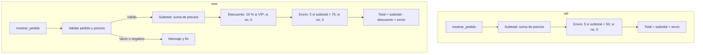

# Informe semántico: `tienda-v1` → `tienda-v2`

## Conclusión principal

La actualización amplía el cálculo y la presentación de pedidos: **activa un descuento VIP del 10 %, valida entradas básicas y muestra un desglose completo**. También elimina el saludo inicial.

Hay un cambio adicional importante que **no figura en `changes`**: `calcular_envio` eleva el umbral de envío gratuito de **50 a 75 EUR**. La consulta de ambas versiones en Ghidra lo confirma, pese a existir una correspondencia propuesta para esa función (`match_0016`).

Para el pedido fijo de `main` —20 + 15 + 25 EUR, cliente VIP— el resultado pasa de **60 EUR a 59 EUR**, no a 54 EUR: los 6 EUR de descuento se compensan parcialmente con los nuevos 5 EUR de envío.

Los metadatos consultados coinciden con los nombres, SHA-256, formato ELF y arquitectura indicados en la entrada.

## Tabla resumen

| Referencias | Función y direcciones old → new | Antes | Después | Impacto |
|---|---|---|---|---|
| `change_0001`, `change_0004`; propuesta alternativa `change_0003` | `mostrar_pedido`: `00101213` → `00101242`; `calcular_descuento`: nueva en `00101213` | Ignora `cliente_vip`; total = subtotal + envío | Descuento del 10 % si VIP es distinto de cero; total = subtotal − descuento + envío | Cambia la política de precios |
| `change_0001` | `mostrar_pedido`: `00101213` → `00101242` | Sin comprobaciones de pedido vacío ni precios negativos | Rechaza puntero nulo, cantidad cero y precios negativos | Mayor robustez, con límites |
| `change_0001`, `change_0005`, `change_0006` | `mostrar_pedido`; thunks `printf` (`00101090`) y `puts` (`00101070`) | Imprime solo el total | Imprime productos, subtotal, descuento, envío y total; añade mensajes de validación | Cambia el formato de salida |
| **Hallazgo adicional**, sin `change_id`; `match_0016` | `calcular_envio`: `001011e7` en ambas versiones | 5 EUR si subtotal < 50; gratis en otro caso | 5 EUR si subtotal < 75; gratis en otro caso | Los subtotales de 50 a menos de 75 EUR dejan de tener envío gratuito |
| `change_0000`, `change_0002`, `change_0006` | `mensaje_bienvenida`: old `00101288`, eliminada; `main`: `001012a2` → `001013e0` | Saludo seguido del pedido | Sin saludo; conserva el mismo pedido de ejemplo | Cambio visible de interfaz |
| `change_0003`, conflictos `conflict_0000` y `conflict_0001` | `calcular_subtotal`: `00101189` en ambas versiones | Suma los precios | Conserva el mismo pseudocódigo de suma | No se observa su sustitución por el descuento; la correspondencia alternativa resulta inadecuada para explicar el comportamiento |

## 1. Cambio conjunto del cálculo del pedido

**Referencias:** `change_0001`, `change_0004` y propuesta conflictiva `change_0003`. Contexto adicional comprobado: `calcular_subtotal`, old/new `00101189`, y `calcular_envio`, old/new `001011e7`.

El diagrama representa el orden observado en `mostrar_pedido` —old `00101213`, new `00101242`— y las reglas recuperadas de sus auxiliares. **El envío se calcula sobre el subtotal original, no sobre el importe tras el descuento.**

### Consecuencias económicas

Para un subtotal finito y no negativo \(S\):

- **Old:** `total = S + (S < 50 ? 5 : 0)`.
- **New:** `total = S − (VIP != 0 ? 0.1 × S : 0) + (S < 75 ? 5 : 0)`.

Esto implica:

- Un cliente no VIP con subtotal entre **50 y menos de 75 EUR** paga **5 EUR más**.
- Un VIP recibe descuento en todas las franjas, pero en esa franja también soporta el nuevo envío.
- Cualquier valor entero **distinto de cero**, no solo `1`, activa el descuento. El código no verifica identidad ni derechos VIP; recibe esa condición del llamador. Esto no demuestra un fallo de autorización.

El aumento del umbral de envío es una observación confirmada en Ghidra, **no una inferencia basada en el resultado del ejemplo**. Puede ser una decisión comercial o una regresión respecto a requisitos desconocidos; no hay especificación para decidirlo.

### Resultado del programa suministrado

Se consultaron `main` old `001012a2` y new `001013e0`. Ambas versiones conservan los precios `[20, 15, 25]`, cantidad `3` y VIP `1`.

| Concepto | old | new |
|---|---:|---:|
| Subtotal | 60 EUR | 60 EUR |
| Descuento aplicado | 0 EUR | 6 EUR |
| Envío | 0 EUR | 5 EUR |
| **Total** | **60 EUR** | **59 EUR** |

Es un resultado deducido del código, no de una ejecución. En este recorrido, las nuevas ramas de rechazo no se activan. La salida pierde el saludo y gana el resumen desglosado (`change_0000`, `change_0001`, `change_0002`).

## 2. Validaciones: mejora real, pero acotada

**Referencia:** `change_0001`, `mostrar_pedido`, old `00101213` → new `00101242`.

La versión nueva añade dos niveles de validación:

1. Si `precios == NULL` **o** `cantidad == 0`, imprime `Pedido vacio` y no calcula importes.
2. Recorre los precios; ante el primero menor que cero, imprime su posición **desde 1** y termina sin resumen.

La diferencia para una cantidad cero es funcional: antes `calcular_subtotal` devolvía cero y el programa calculaba un total de **5 EUR de envío**; ahora solo informa de que el pedido está vacío. Un puntero nulo con cantidad positiva antes se desreferenciaba en la suma y ahora se rechaza antes de leerlo.

### Límites observables

- **No se comprueba la longitud real del arreglo.** Un puntero no nulo no garantiza que existan `cantidad` elementos accesibles. Una cantidad incorrecta podría provocar lecturas fuera de límites; esa precondición ya existía en la versión anterior.
- La condición `precio < 0.0` **no garantiza que el precio sea finito**: no añade una comprobación de NaN o infinito. Valores no finitos o una suma desbordada podrían propagarse al total.
- `calcular_subtotal` sigue sin validaciones propias en new `00101189`; la protección está en su llamador.
- `mostrar_pedido` sigue devolviendo `void`: comunica los rechazos por salida textual, no mediante un estado de error.

Estas son limitaciones de la interfaz observada, **no vulnerabilidades explotables demostradas**. El único llamador identificado por Ghidra es `main`, que pasa un arreglo fijo válido; no se ha establecido una vía de entrada controlada por un atacante.

## 3. Resolución de las propuestas incompatibles

**Referencias:** `change_0003`, `change_0004`, `match_0001`, `match_0002`, `conflict_0000` y `conflict_0001`.

Las propuestas tienen distinta procedencia:

| Propuesta | Procedencia del JSON | Interpretación propuesta |
|---|---|---|
| `change_0003` | `VersionTrackingDiff`, `$.functions.modified[2]`, `Implied Match` | `calcular_subtotal` old se transforma en `calcular_descuento` new |
| `change_0004` | `SimpleDiff` y `StructualGraphDiff`, `$.functions.added[0]` | Se añade `calcular_descuento` |
| `match_0001` | `VersionTrackingDiff`, `$.matches.address_matches["00101189"][0]` | Subtotal old corresponde a subtotal new |
| `match_0002` | `VersionTrackingDiff`, `$.matches.address_matches["00101189"][1]` | El mismo subtotal old corresponde al descuento new |

La inspección directa aclara la interpretación semántica:

- Old `calcular_subtotal` `00101189` y new `calcular_subtotal` `00101189` presentan la misma firma y el mismo pseudocódigo de acumulación.
- New `calcular_descuento` `00101213` es una función distinta, con parámetros y operación diferentes.
- New `mostrar_pedido` `00101242` **llama a ambas**.

Por tanto, la explicación respaldada es **conservación del subtotal y adición del descuento**, no sustitución de una operación por otra. La conclusión se apoya en los cuerpos y llamadas consultados, no en una votación entre motores. No permite reconstruir por sí sola la historia del código fuente.

Además, `match_0016` —`VersionTrackingDiff`, `$.matches.address_matches["001011e7"][0]`— no implica equivalencia: la función de envío conserva identidad y dirección, pero cambia su umbral. La ausencia de una propuesta en `changes` no excluía este cambio.

## 4. Salida e importaciones: cambios derivados, no nuevas primitivas

**Referencias:** `change_0000`, `change_0001`, `change_0002`, `change_0005` y `change_0006`.

La eliminación de `mensaje_bienvenida` old `00101288` y de su llamada desde `main` explica la desaparición del saludo. El inventario completo de funciones no externas de new no contiene esa función.

Los registros de `printf` y `puts` reflejan el nuevo uso de la salida:

- `printf` pasa de una referencia a seis: cinco llamadas en el resumen y una en la rama de precio inválido. **No son seis llamadas ejecutadas en cada pedido.**
- `puts` deja de usarse para el saludo y se utiliza desde `mostrar_pedido` para el resumen o el pedido vacío.

Ghidra identifica `printf` new `00101090` y `puts` new `00101070` como **thunks**. El pseudocódigo aparentemente autorreferente de estos registros no demuestra recursión ni una reimplementación de libc. Los formatos observados en `mostrar_pedido` son constantes.

Las importaciones consultadas de new contienen salida estándar y soporte de ejecución; no aportan evidencia de operaciones de red, lanzamiento de procesos o persistencia. Esta observación no constituye una auditoría exhaustiva de todo el binario.

## Efecto conjunto y limitaciones

**La actualización modifica la política de cobro, endurece parcialmente la entrada y cambia la interfaz textual.** El descuento VIP y el aumento del umbral de envío deben interpretarse juntos: para el ejemplo incluido, la mejora neta es de solo **1 EUR**. También podrían romperse consumidores que esperasen el saludo o una salida formada únicamente por el total.

Se comprobaron en Ghidra las funciones centrales, sus llamadas, los auxiliares de subtotal y envío en ambas versiones, el inventario de funciones de new y sus importaciones. Quedan sin determinar la intención comercial, la compatibilidad esperada de la salida y la alcanzabilidad de entradas inválidas fuera del `main` observado.

El análisis es estático y utiliza pseudocódigo descompilado: **no se ejecutaron pruebas, no se verificó equivalencia byte a byte y no se realizó una auditoría completa del arranque o de todas las funciones auxiliares**. La evidencia permite afirmar los cambios descritos, pero no atribuir intención maliciosa ni demostrar explotabilidad.
